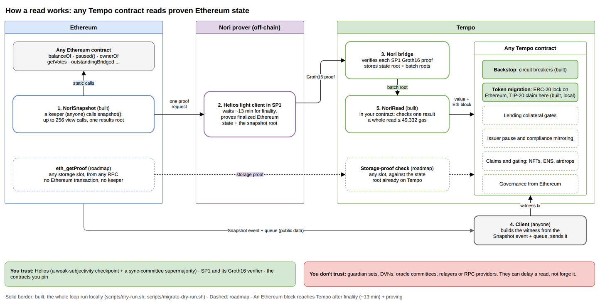

# Nori: World's Fair submission

Read Ethereum state from any Tempo contract, proven instead of relayed.



## Where it stands (9 Oct)

- **Built and tested on local chains:** `NoriRead`, Backstop, the keeper and a fake
  prover. `scripts/dry-run.sh` runs the whole loop on a Sepolia fork and a local Tempo
  node: draining the lockbox trips the guard, and a refill doesn't reset it.
- **Next:** Ethereum Sepolia → Tempo Moderato on real Nori proofs.

Addresses and numbers: [docs/README.md](docs/README.md).

## Repo

| Path            | What                                                                                                                                   |
| --------------- | -------------------------------------------------------------------------------------------------------------------------------------- |
| `ethereum/`     | `NoriSnapshot` contract, query list, deploy and snapshot tasks                                                                         |
| `tempo/`        | Solidity: `NoriRead` (verify a snapshot result in one call), `NoriReadExample`, Backstop (circuit breaker) ([README](tempo/README.md)) |
| `client/`       | Sample TS client and keeper CLI: create-guards, snapshot, checkpoint, submit, status, unlatch, run                                     |
| `web/`          | Browser apps: prove an Ethereum balance on Tempo, and a live dashboard of the proof queue ([README](web/README.md))                    |
| `test-vectors/` | Test data shared by the contract and client tests                                                                                      |
| `scripts/`      | `dry-run.sh` (the whole loop locally), `dev-local.sh` (the web apps on local chains), `outage.sh` (freeze or resume a local chain), `local-chains.sh` (the chains both start), `deploy-moderato.sh` (Backstop + demo token), `soak.sh` (keeper for hours, then a report) |
| `docs/`         | [Index of all docs](docs/README.md), diagrams, deployments                                                                             |

## Run

```sh
git clone https://github.com/Nori-zk/nori-worldsfair-submission-tempo
npm install && npm run build
anvil --network tempo &  # the tempo/ tests' local node
npm test                 # ethereum contracts, the tempo contracts, then the client
npm run lint             # every workspace
scripts/dry-run.sh       # the whole loop on local chains, with a fake prover
npm run dev:local        # the web apps on local chains
npm run outage -- eth|tempo down|up  # freeze or resume one of those chains
```

Toolchain notes: [AGENTS.md](AGENTS.md).
The Nori SDK comes from npm: each `package.json` pins its packages to exact versions
from one release of `../nori-tempo-sdk`.

## Apps

Browser apps on Sepolia + Tempo Moderato ([web/README.md](web/README.md)); they need the Nori
bridge's address in `web/.env`:

```sh
npm run dev -w web/apps/prove-balance   # prove an address's ETH or token balance on Tempo: http://localhost:5180
npm run dev -w web/dashboards/bridge    # every proof request from Ethereum to Tempo, live: http://localhost:7400
```

## Deploy (Sepolia + Tempo Moderato)

Keys and addresses live in one `.env`: `cp .env.example .env`, then fill it in. The Tempo
account pays its fees in pathUSD (Moderato's faucet).

```sh
# Ethereum: NoriSnapshot on the existing queue, and a demo lockbox
npm run deploy -w ethereum                     # -> ethereum/.env.nori-eth-snapshot
npm run deploy-demo -w ethereum -- 116723.52   # -> ethereum/.env.nori-eth-demo

# Tempo: Backstop, and a demo TIP-20 with supply 116,700 (-> tempo/.env.nori-tempo-*); safe to rerun
scripts/deploy-moderato.sh

# Keeper: client/keeper.demo.json reads .env and the deploy outputs
npm run keeper -w client -- create-guards
npm run keeper -w client -- status   # Nori's progress through the queue, then each guard
npm run keeper -w client -- run
```

bridge-head proves `NORI_ETH_PROOF_QUEUE_ADDRESS` and updates `NORI_TEMPO_TOKEN_BRIDGE_ADDRESS`.
Create guards only after that bridge is deployed: a guard pins it.

## Built vs roadmap

|                                                                                         | Status                           |
| --------------------------------------------------------------------------------------- | -------------------------------- |
| NoriSnapshot (batched reads) and `NoriRead`                                             | Built                            |
| Backstop guards: trip rule, latch, paused-at-source, stale, `assertHealthy` for lenders | Built                            |
| Keeper, local dry run                                                                   | Built                            |
| Browser apps: prove a balance, bridge dashboard                                         | Built (Sepolia + Tempo Moderato) |
| Live loop on Sepolia + Tempo Moderato                                                   | Next                             |
| `enforce`: pause the TIP-20 when its guard trips                                        | Roadmap                          |
| Separate warn tolerance (in-flight transfers) from the trip tolerance                   | Roadmap (one `tolerance` today)  |
| Auto-unlatch for Tempo-only custody; timelocked admin `unlatch`                         | Roadmap (admin `unlatch` today)  |
| Check the TIP-20's issuer is the expected bridge                                        | Roadmap                          |
| Direct storage proofs: any slot, no Ethereum transaction                                | Roadmap                          |

Direct proofs work because each Nori update already puts Ethereum's state
root on Tempo. The hackathon build uses snapshots through the existing proof queue.
