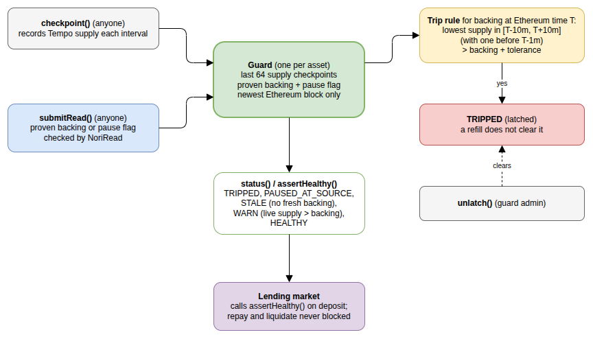

# NoriRead and Backstop

Solidity for Tempo (`@nori-zk/tempo-backstop`): `NoriRead` verifies one `NoriSnapshot`
result against a proof queue batch that the Nori bridge (`NoriTempoTokenBridge`) committed,
and `Backstop` is a circuit breaker built on it.

## NoriRead

A library ([`contracts/NoriRead.sol`](contracts/NoriRead.sol)). A whole read in
[`NoriReadExample`](contracts/NoriReadExample.sol), the smallest consumer, costs at most
49,332 gas over the ten mainnet queries.

```solidity
INoriTempoTokenBridge.ProofRequestRootEntry memory batch =
    NoriRead.loadProofQueueBatch(NORI_BRIDGE, proofQueueBatchIndex);
NoriRead.ProvenResult memory proven =
    NoriRead.verifySnapshotResult(NORI_BRIDGE, batch, NORI_SNAPSHOT, QUERY_ID, witness);
// proven.result, proven.ethBlockNumber, proven.ethTimestamp
```

The witness is built off-chain from the `Snapshot` event and the queue
(`fetchProvenSnapshot` in [`client/`](../client)).

Your contract must:

- pin the Nori bridge, the `NoriSnapshot` address and the query ids it acts on (never take them from the caller);
- reject stale results, and keep the newest `ethBlockNumber` per query: old snapshots stay valid;
- query only contracts whose views it trusts: a result is proven to be what the contract returned, not that it is true. A precompile or an upgradeable contract returns whatever its code or admin decides.

`loadProofQueueBatch` reads the batch from the bridge, which reverts with
`ProofQueueBatchNotCommitted` for an index it has not committed. `verifySnapshotResult`
checks the request leaf against the batch root (through the bridge's own witness hashing)
and the batch's cursor range, the leaf itself (target, two keys, top-bit sentinel, nonzero
index and time), then the result against the results root. Each failure is its own custom
error. The data format is in [`NoriSnapshot.sol`](../ethereum/contracts/NoriSnapshot.sol).

## Backstop

A circuit breaker for one bridged asset: a guard compares its Ethereum backing, proven
through Nori, with the supply of its TIP-20 on Tempo
([`contracts/Backstop.sol`](contracts/Backstop.sol), rules in
[`BackstopRules.sol`](contracts/BackstopRules.sol)).



| Function                                                   | Who                       | Does                                                                     |
| ---------------------------------------------------------- | ------------------------- | ------------------------------------------------------------------------ |
| `createGuard(token, config)`                               | anyone (becomes admin)    | Pins the token, Nori bridge, NoriSnapshot, and backing and pause queries |
| `checkpoint(guardId)`                                      | anyone, once per interval | Records the token's supply (the last 64 are kept)                        |
| `submitRead(guardId, kind, proofQueueBatchIndex, witness)` | anyone                    | Applies a proven backing or pause flag (newer blocks only)               |
| `status(guardId)` / `assertHealthy(guardId)`               | lenders (views)           | Return the status, or revert unless it is HEALTHY                        |
| `unlatch(guardId)`                                         | admin                     | Clears a trip                                                            |

A guard's id is `guardIdOf(token, admin)`, `keccak256(abi.encode(token, admin))`, and its
config is fixed at creation, so one admin has one guard per token; a new config needs
another admin key. Lenders should check the guard's config (`guard(guardId)`), not just its
id. A pause query must return a bool: any other word reverts with `PauseResultNotBool`, so
a misconfigured query can't latch PAUSED_AT_SOURCE.

Gas, from the Kelp replay test: `submitRead` 337,042 for a guard's first backing read (it
writes the guard's backing slot for the first time; a new slot costs 250,000 on Tempo),
87,651 for a later one and 61,063 for a pause read; `assertHealthy` 38,322.

## Commands

The tests run on a local Tempo node at `http://127.0.0.1:8545`.

```sh
npm run build -w tempo
anvil --network tempo &
npm run test -w tempo         # guard rules, Kelp replay, NoriRead vectors, NoriReadExample
npm run deploy -w tempo       # Backstop -> tempo/.env.nori-tempo-backstop
npm run deploy-demo -w tempo -- 116700   # a demo TIP-20 -> tempo/.env.nori-tempo-demo
```

```
  Kelp replay
      submitRead: 337042 gas (backing), 61063 (pause)
      assertHealthy: 38322 gas
      submitRead: 87651 gas (a later backing read)
    ✔ the drain trips the guard, and a refill does not reset it
    ✔ rejects a pause query that is not a bool
  ...
  NoriReadExample
      readSnapshotResult: at most 49332 gas over 10 queries
    ✔ reads every mainnet query on chain
    ✔ rejects forged results and batches the bridge has not committed

  26 passing (5s)
```

The Solidity constants are mirrored in `contracts/*.const.ts`, exported from the package.
The tests check `NoriRead` against [`test-vectors/nori-snapshot`](../test-vectors/nori-snapshot).
